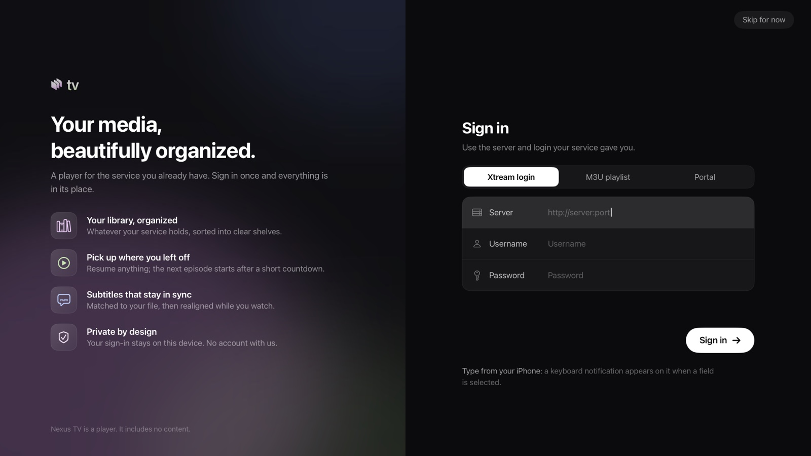
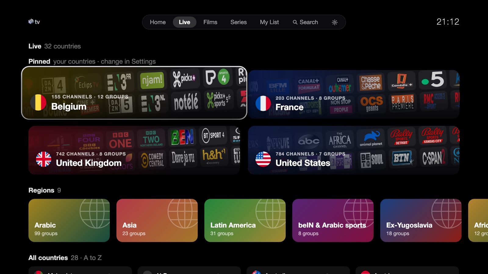
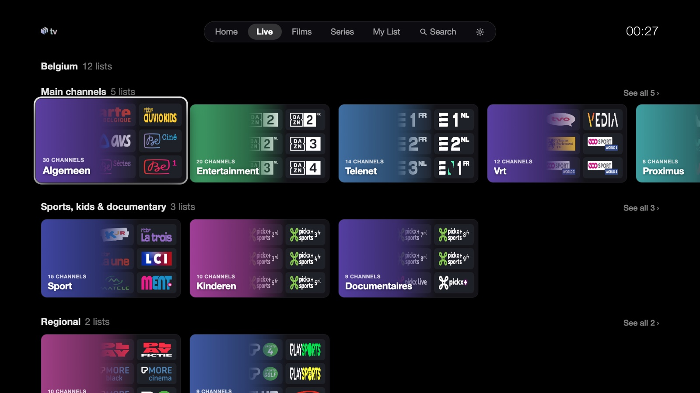
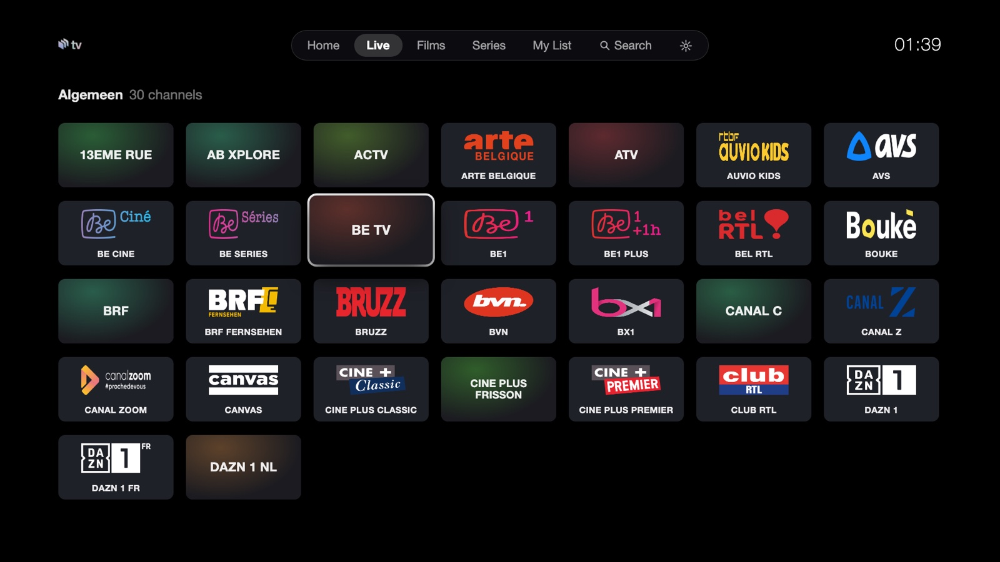
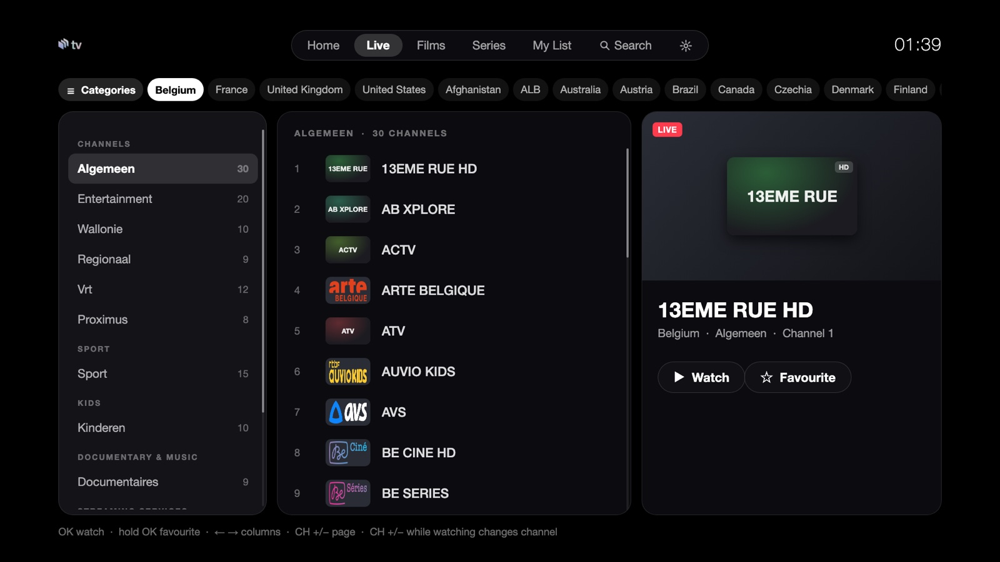
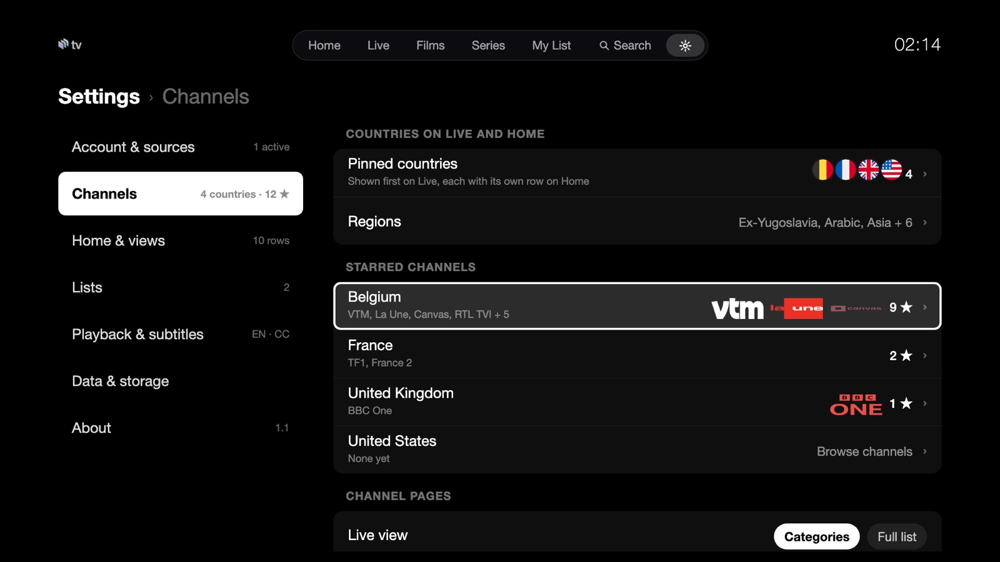

<p align="center">
  
</p>

<p align="center">
  <a href="#apple-tv"></a>
  <a href="#mac"></a>
  <a href="#samsung-tv"></a>
  
  
  
  <a href="LICENSE"></a>
</p>

<p align="center">
  <b>Live TV, films and series from your own provider, in an app that feels like it belongs on the TV.</b><br>
  Three apps, one look: Apple TV and Mac in Swift, Samsung TVs as a Tizen web app. No account, channel list or content inside.
</p>

---

## Get the app

| Platform | How to get it |
|---|---|
| **Apple TV** | Through **TestFlight**: install the TestFlight app on the Apple TV, then redeem the invite you received. Or build it yourself (below). |
| **Mac** | Build it yourself (below), five minutes with Xcode. |
| **Samsung TV** | Build the Tizen package in `samsung/` and install it with Tizen Studio (below). Tested on a 2017 Frame (Tizen 3.0). |
| **iPhone and iPad** | Planned. The shared code is ready for it. |

On first launch the app asks for a source. It checks the login with the provider and keeps it on the device.

<p align="center">
  
</p>

## Bring your own source

Three kinds of source, on every platform, added at first launch or later in **Settings › Account & sources**:

| Source | What you enter | Notes |
|---|---|---|
| **Xtream login** | server, username, password | Live, films and series with artwork and categories. A `get.php` export link signs in through this path too. |
| **M3U playlist** | a link | A very big playlist first shows its groups with their counts; tick the ones to keep and the rest streams in the background. |
| **Stalker / MAG portal** | portal address and MAC | The portal's own live and on-demand lists. |

Several sources can be kept and switched. Nothing is sent anywhere but to your provider. If your account allows one
stream at a time, the app says so when another device holds it, and waits for it to be free; a paused or hidden app
gives the stream back by itself.

## A tour

<p align="center">
  
</p>

<table>
  <tr>
    <td width="50%"><br><sub><b>Live</b>: your countries as banner cards with their channel logos, then regions, then every country A to Z. The same page on Apple TV and on the Mac.</sub></td>
    <td width="50%"><br><sub><b>A country</b>: its lists as shelves with clean names, channels, sport, kids, documentary, regional; events and pay-per-view last.</sub></td>
  </tr>
  <tr>
    <td width="50%"><br><sub><b>A list</b>: its channels as logo tiles. Channels with no logo get a tile in their name's colour. Up and down change channel while watching.</sub></td>
    <td width="50%"><br><sub><b>Full list</b>: the classic three-column guide with a preview, one press away from the categories view.</sub></td>
  </tr>
  <tr>
    <td width="50%"><br><sub><b>Films and series</b>: streaming services, genres, 4K, kids, world cinema, collections, as shelves of banner cards. Small lists stay out of the way.</sub></td>
    <td width="50%"><br><sub><b>The same shelves on Apple TV</b>, built for the Siri Remote.</sub></td>
  </tr>
  <tr>
    <td width="50%"><br><sub><b>Player</b>: controls that hide by themselves, 10 s jumps, audio, subtitles, picture in picture, full screen. On Apple TV, scrubbing shows the real frame at the marker.</sub></td>
    <td width="50%"><br><sub><b>Next episode</b>: a card with the episode's picture and a countdown over the credits; Play now or Keep watching.</sub></td>
  </tr>
  <tr>
    <td width="50%"><br><sub><b>Subtitles that stay in sync</b>: pick an online subtitle and the app lines it up with the speech by itself (how, below).</sub></td>
    <td width="50%"><br><sub><b>Settings</b>: seven sections with a live summary each; rows with their value, flags, logos, switches. Same on every platform.</sub></td>
  </tr>
  <tr>
    <td width="50%"><br><sub><b>Make Home yours</b>: long press a tile on the TVs, right-click on the Mac: favourite, My List, move, hide the row.</sub></td>
    <td width="50%"><br><sub><b>Search everything</b>: channels, films and series together, your countries and languages first, the rest after.</sub></td>
  </tr>
</table>

## Features

| | |
|---|---|
| 🏠 **Home** | A featured title on top, then rows: Continue watching, My List, a live row per country, New films, Top series, and any category you add. Rows and tiles move, hide and come back from Settings. |
| 📺 **Live** | Two views: **Categories** (countries as cards, a country as shelves, a list as logo tiles) and **Full list** (the three-column guide with a preview). Favourite channels come first. Up and down zap while watching. |
| 🎬 **Films and series** | Shelves per family with banner cards, a language filter, detail pages, seasons and episodes with their progress. Next episode plays by itself after a countdown. A **CC** badge marks titles known to have subtitles. |
| 🔎 **Search** | Everything at once: channels, films and series, in every language. On Apple TV, Apple's own search screen with dictation and typing from an iPhone. On the Mac, ⌘F. |
| ▶️ **Player** | VLCKit on Apple TV and Mac, the TV's own player on Samsung. Audio and subtitle tracks named by language, your preferred language chosen at open and remembered across titles. Reconnects by itself after a drop. |
| 💬 **Online subtitles, in sync** | Optional, with your own OpenSubtitles account. The app first asks for subtitles made for your exact file (a fingerprint of the video), then the same release. Then it **aligns** them: before the film opens, it reads the start time of every line of the file's own subtitle track from the file's index (a few small reads, no download), and votes the offset that makes the downloaded lines land on those times, frame-rate difference included. The offset holds through seeks. With no index (MP4), it listens to the embedded track while you watch and aligns within a minute of dialogue. Earlier / Later still nudges by half a second, kept per file. |
| ⚙️ **Settings** | **Account & sources** (add, switch, rename, remove, choose groups, refresh), **Channels** (countries, starred channels per country, Live view), **Home & views** (rows in order, menu tabs, reset), **Lists**, **Playback & subtitles** (audio and subtitle languages, OpenSubtitles), **Data & storage**, **About**. |
| 🖼 **Logos** | A channel logo comes from the provider, a built-in map of 11,000 channels, or the public iptv-org index, whichever answers first; a dead logo server never leaves a blank tile. Round flags for every country. |

After a source is added, the app downloads the full catalogue in the background to build its search index. A small line
shows the progress; Home and browsing never wait for it. The index refreshes once a day.

## Build and run

### Apple TV and Mac

You need a Mac with **Xcode 26 or later** and [XcodeGen](https://github.com/yonaskolb/XcodeGen).

```bash
brew install xcodegen
git clone https://github.com/achammah/nexus-tv.git && cd nexus-tv
scripts/setup.sh          # signing team, VLCKit (large download, kept outside git), Xcode project
open NexusTV.xcodeproj
```

- **Signing**: `scripts/setup.sh` writes the git-ignored `Config/Signing.xcconfig` from the "Apple Development" identity in your keychain. Without one, copy `Config/Signing.example.xcconfig` to `Config/Signing.xcconfig` and set your team id, or pick the team in Xcode.

#### Apple TV

Scheme **NexusTV**. Pick an Apple TV simulator or your Apple TV, then Run. From the command line:

```bash
xcodebuild -project NexusTV.xcodeproj -scheme NexusTV \
  -destination 'platform=tvOS Simulator,name=Apple TV 4K (3rd generation)' build
```

<details>
<summary><b>Install on your own Apple TV</b></summary>

1. Put the Apple TV and the Mac on the same network. On the Apple TV open **Settings › Remotes and Devices › Remote App and Devices** and leave that screen open.
2. On the Mac open **Xcode › Window › Devices and Simulators**. The Apple TV appears under *Discovered*: click **Pair** and type the code shown on the TV.
3. Choose the Apple TV as run destination and press **Run**.
4. With a free Apple ID the app runs for 7 days; with a paid developer account, a year. Rebuild to renew, or distribute it through TestFlight.

</details>

#### Mac

Scheme **NexusTVMac**, destination *My Mac*, then Run. From the command line:

```bash
xcodebuild -project NexusTV.xcodeproj -scheme NexusTVMac -destination platform=macOS build
```

The app lands in Xcode's build products folder (`Nexus TV.app`); drag it to Applications. Sign the build with your
Apple Development identity, or the Keychain asks for permission at every launch. Keys: ⌘F search, ⌘[ and ⌘] back and
forward, ⌘, Settings. In the player: space play or pause, ← → 10 s, ↑ ↓ change channel, F full screen, Esc leaves full
screen, then picture in picture, then the player. Right-click a tile on Home for its menu.

### Samsung TV

The Samsung app lives in [`samsung/`](samsung/): plain ES5 and absolute layout, because the TVs run an old browser
engine (a 2017 Frame runs Chromium 47). Everything the Apple apps do is there, drawn the same way.

```bash
cd samsung
tools/build_data.py                  # the live, film and series data files from your source (kept out of git)
tools/bundle_logos.py be             # copies a country's channel logos into the app (optional, for dead logo servers)
TV=<your-tv-ip> tools/package.sh     # package with your Samsung certificate profile, install, open
```

You need [Tizen Studio](https://developer.samsung.com/smarttv/develop/getting-started/setting-up-sdk/installing-tv-sdk.html)
with its CLI tools, a certificate profile named `frame`, and Developer mode on the TV with your Mac's address. The
package reads your source from `data/config.js`, which you write once and never commit.

<details>
<summary><b>Tests</b></summary>

- `NXTV_ACCOUNT_FILE=<file> scripts/uitest.sh`: Apple TV journeys driven with the Siri Remote (`XCUIRemote`) on the simulator whose id is in `build/sim-udid`. The file holds a real test login on 3 lines (server, username, password); keep it outside the repo. Logs are masked; captures go to `shots/remote/` (git-ignored).
- `scripts/mactest.sh`: the Mac journeys (they take the mouse and keyboard while they run).
- `scripts/perf.sh`, `scripts/perfkeys.sh`: speed runs with in-app metrics (`-NXMetrics YES`).
- `scripts/netcut.sh live|film`: plays through a local stand-in server and cuts it, to check the reconnect.
- The Samsung app is driven headless in Chromium with sample data (key events only); the Matroska subtitle index reader is checked against ffprobe on a generated MKV.
- More in [docs/TESTING.md](docs/TESTING.md).

</details>

## Project layout

One repository, one shared Swift core, one folder per platform.

```
Shared/      Xtream, M3U and portal sources, catalogue, caches, stores, subtitles, logos, VLCKit controller, the opening
tvOS/        the Apple TV app: entry point, screens, Settings, assets
macOS/       the Mac app: window, sidebar, pages, player view, assets
samsung/     the Samsung TV app (Tizen web app, ES5): screens, player, sources, subtitle sync, tools
iOS/         planned
Tests/       remote-driven journeys (tvOS), Mac journeys and unit tests
scripts/     setup, build, test and TestFlight helpers
project.yml  XcodeGen: targets NexusTV (tvOS) and NexusTVMac (macOS)
```

Git-ignored: `Vendor/` (VLCKit), `Config/Signing.xcconfig`, `build/`, `samsung/data/`, copied logos.

## Contributing

Issues and pull requests are welcome. Please never commit a provider address, a login or a catalogue file: the tests
read their login from a file outside the repo (`NXTV_ACCOUNT_FILE`).

## License

The code is under the [MIT license](LICENSE). VLCKit is downloaded at setup and is under the LGPL 2.1 (VideoLAN).
The round flags are [circle-flags](https://github.com/HatScripts/circle-flags) (MIT). The Nexus name and logo are not
covered by the MIT license.

> Nexus TV is a player only. It does not provide, host or link to any content. Use it only with a provider and streams
> you have the right to watch.
