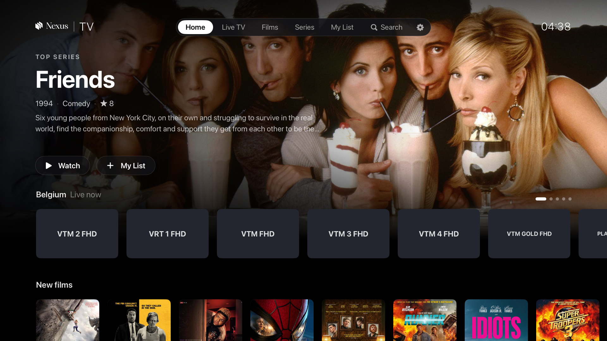
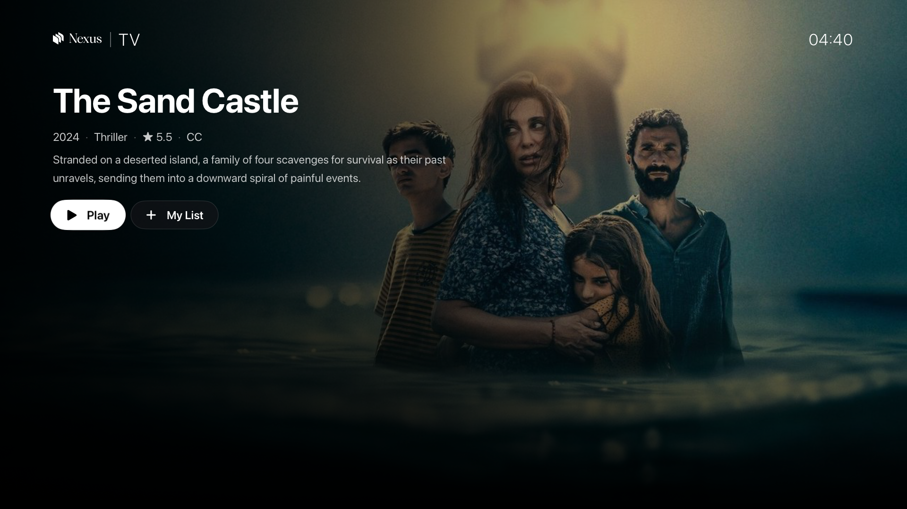
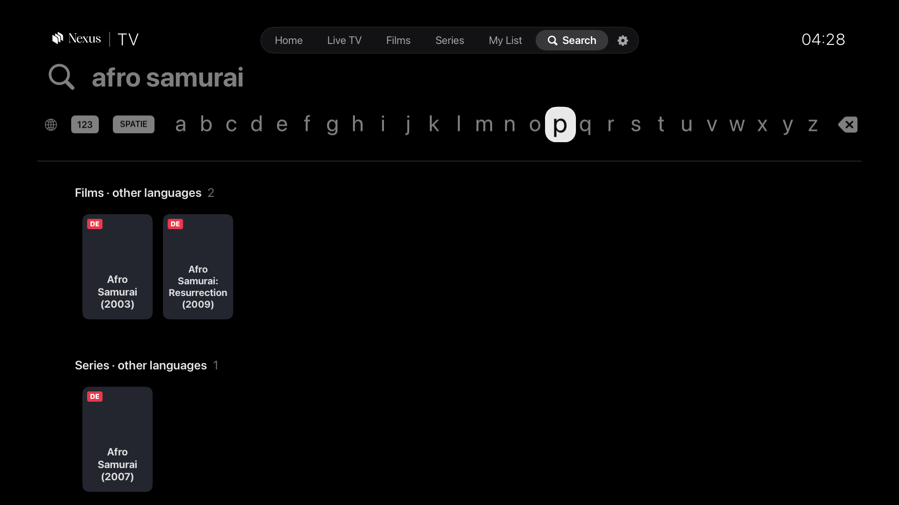
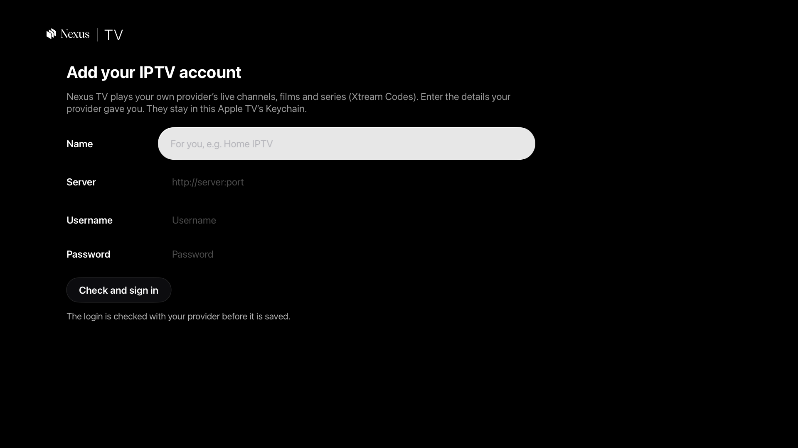

<p align="center">
  
</p>

<p align="center">
  <a href="#build-and-run"></a>
  
  
  <a href="LICENSE"></a>
</p>

<p align="center">
  <b>Live TV, films and series from your own IPTV provider, in an app that feels like it belongs on Apple TV.</b><br>
  Built for the Siri Remote. Fast to browse. No account, channel list or content inside.
</p>

---

## Bring your own provider

Nexus TV works with any provider that uses the **Xtream Codes** API. The app ships empty: on first launch it asks for the
server, username and password your provider gave you, checks them with the provider, and keeps them in the Apple TV
Keychain. Nothing is sent anywhere else.

<p align="center">
  
</p>

<table>
  <tr>
    <td width="50%"><br><sub><b>Film and series pages</b>: plot, rating, subtitles badge, resume.</sub></td>
    <td width="50%"><br><sub><b>Search everything</b>: every channel, film and series, in every language.</sub></td>
  </tr>
  <tr>
    <td width="50%"><br><sub><b>First launch</b>: add your provider; type from your iPhone.</sub></td>
    <td width="50%">

**Highlights**
- Apple TV style Home with a rotating featured title
- Channel guide by country and category
- Live scrubbing, audio and subtitle tracks
- Auto reconnect when a stream drops
- Long press menus, move tiles, favourites
- Several accounts, switch in Settings

</td>
  </tr>
</table>

## Features

| | |
|---|---|
| 🏠 **Home** | Featured series on top, then rows: Continue watching, My List, a live row per country, New films, Top series, and any category you add. Long press a tile to favourite it, add it to My List, move it within its row, or hide the row. |
| 📺 **Live TV** | Countries, categories, channels and a preview. Favourite channels come first in their country row. Up and down on the remote change channel. |
| 🎬 **Films and series** | Categories by language, detail pages, seasons and episodes, next episode plays by itself. A **CC** badge shows titles known to have subtitles. |
| 🔎 **Search** | Apple's own search screen: keyboard, dictation, typing from an iPhone. Your languages and countries first, then everything else with a small language badge. |
| ▶️ **Player** | VLCKit, live and on demand. Audio and subtitle choice remembered per film and per series. Live scrubbing shows the real frame. One stream at a time; it reconnects by itself after a network drop and stops when the app goes to the background. |
| ⚙️ **Settings** | Menu tabs and Home rows (show, hide, reorder), countries, languages, **Lists** (any category of your account as a Home row), **Channels** (star any channel), **Accounts** (add, switch, remove), clear lists. |

After an account is added, the app downloads the full catalogue in the background to build its search index. A small
line shows the progress; Home and browsing never wait for it. The index refreshes once a day.

## Build and run

You need a Mac with **Xcode 16 or later** and [XcodeGen](https://github.com/yonaskolb/XcodeGen).

```bash
brew install xcodegen
git clone https://github.com/achammah/nexus-tv.git && cd nexus-tv
scripts/setup.sh          # signing team, TVVLCKit (≈780 MB download, 245 MB kept), Xcode project
open NexusTV.xcodeproj    # pick an Apple TV simulator or your Apple TV, then Run
```

- **Signing**: `scripts/setup.sh` writes the git-ignored `Config/Signing.xcconfig` from the "Apple Development" identity in your keychain. Without one, copy `Config/Signing.example.xcconfig` to `Config/Signing.xcconfig` and set your team id, or pick the team in Xcode.
- **Simulator from the command line**:
  ```bash
  xcodebuild -project NexusTV.xcodeproj -scheme NexusTV \
    -destination 'platform=tvOS Simulator,name=Apple TV 4K (3rd generation)' build
  ```

<details>
<summary><b>Install on your own Apple TV</b></summary>

1. Put the Apple TV and the Mac on the same network. On the Apple TV open **Settings › Remotes and Devices › Remote App and Devices** and leave that screen open.
2. On the Mac open **Xcode › Window › Devices and Simulators**. The Apple TV appears under *Discovered*: click **Pair** and type the code shown on the TV.
3. Choose the Apple TV as run destination and press **Run**.
4. With a free Apple ID the app runs for 7 days; with a paid developer account, a year. Rebuild to renew, or distribute it through TestFlight.

</details>

<details>
<summary><b>Tests</b></summary>

- `NXTV_ACCOUNT_FILE=<file> scripts/uitest.sh`: journeys driven with the Siri Remote (`XCUIRemote`) on the simulator whose id is in `build/sim-udid`. The file holds a real test login on 3 lines (server, username, password); keep it outside the repo. Logs are masked; captures go to `shots/remote/` (git-ignored).
- `scripts/perf.sh`, `scripts/perfkeys.sh`: speed runs with in-app metrics (`-NXMetrics YES`).
- `scripts/netcut.sh live|film`: plays through a local stand-in server and cuts it, to check the reconnect.
- More in [docs/TESTING.md](docs/TESTING.md).

</details>

## Project layout

```
NexusTV/
  App/        entry point and navigation
  Core/       Xtream client, catalogue, caches, stores
  Views/      screens
  Player/     VLCKit player
NexusTVUITests/  remote-driven journeys
scripts/         setup, build and test helpers
```

Git-ignored: `Vendor/` (TVVLCKit), `Config/Signing.xcconfig`, `build/`.

## Contributing

Issues and pull requests are welcome. Please never commit a provider address, a login or a catalogue file: the tests
read their login from a file outside the repo (`NXTV_ACCOUNT_FILE`).

## License

The code is under the [MIT license](LICENSE). TVVLCKit is downloaded at setup and is under the LGPL 2.1 (VideoLAN).
The Nexus name and logo are not covered by the MIT license.

> Nexus TV is a player only. It does not provide, host or link to any content. Use it only with a provider and streams
> you have the right to watch.
