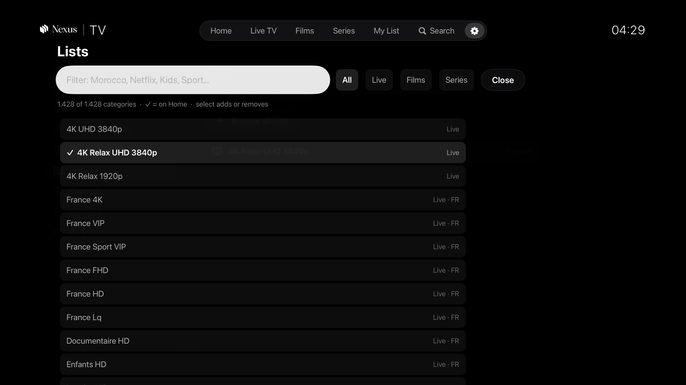

# Nexus TV for Apple TV

A native tvOS player for IPTV providers that use the **Xtream Codes** API (SwiftUI, tvOS 17+, VLCKit).
Live TV with a channel guide, films, series, search across the whole catalogue, a resumable player.

**Bring your own provider.** The app ships with no account, channel list or catalogue. On first launch it asks for the
server address, username and password your provider gave you, checks them with the provider, and keeps them in the
Apple TV's Keychain. Nothing is sent anywhere else.


| | |
|---|---|
|  |  |
|  |  |

## What it does
- **Home**: featured series, then rows: Continue watching, My List, one row per chosen country, New films, Top series, and any category you add. Long press a tile: favourite, My List, move it within its row, hide the row.
- **Live TV**: countries, categories, channels, preview. Favourite channels go first in their country row.
- **Films / Series**: categories by language, detail pages, seasons and episodes.
- **Search**: Apple's search screen (keyboard, dictation, typing from an iPhone). Results from your languages and countries first, then every other language and country, each with a badge.
- **Player** (VLCKit): live and on demand, audio and subtitle tracks (remembered per film and per series), next episode, scrubbing. One stream at a time; it reconnects by itself after a network drop and stops when the app goes to the background.
- **Settings**: menu tabs, Home rows, countries, languages, Lists (any category as a Home row), Channels (star any channel), Accounts (add, switch, remove), clear lists.
- **Online subtitles** (optional): with your own OpenSubtitles account (Settings › Subtitles: API key, username, password, kept in the Keychain), the CC menu also lists online subtitles in your languages. A pick uses one download; for a series, the next episode takes the same language by itself.

The first time an account is added, the app downloads the full lists in the background to build its search index;
a small line shows the progress. Home and browsing do not wait for it. The index refreshes once a day.

## Build and run
Needs a Mac with Xcode 16 or later and [XcodeGen](https://github.com/yonaskolb/XcodeGen) (`brew install xcodegen`).

```
scripts/setup.sh          # signing team, TVVLCKit (about 780 MB download, 245 MB kept), Xcode project
open NexusTV.xcodeproj    # pick an Apple TV simulator or your Apple TV, then Run
```

- **Signing**: `scripts/setup.sh` writes the git-ignored `Config/Signing.xcconfig` from the "Apple Development" identity in your keychain. Without one, copy `Config/Signing.example.xcconfig` to `Config/Signing.xcconfig` and set your team id, or pick the team in Xcode.
- **Simulator from the command line**: `xcodebuild -project NexusTV.xcodeproj -scheme NexusTV -destination 'platform=tvOS Simulator,name=Apple TV 4K (3rd generation)' build`

### Install on your Apple TV
1. Apple TV and Mac on the same network. On the Apple TV: Settings › Remotes and Devices › Remote App and Devices (leave this screen open).
2. On the Mac: Xcode › Window › Devices and Simulators. The Apple TV appears under "Discovered": Pair, then type the code shown on the TV.
3. Pick the Apple TV as run destination and press Run.
4. With a free Apple ID the app runs for 7 days; with a paid developer account, a year. Rebuild to renew.

## Tests
- `NXTV_ACCOUNT_FILE=<file> scripts/uitest.sh`: journeys driven with the Siri Remote (XCUIRemote) on the simulator whose id is in `build/sim-udid`. The file holds a real test login on 3 lines (server, username, password); keep it outside the repo. Logs are masked; captures go to `shots/remote/` (git-ignored).
- `scripts/perf.sh`, `scripts/perfkeys.sh`: speed runs with in-app metrics (`-NXMetrics YES`).
- `scripts/netcut.sh live|film`: plays through a local stand-in server and cuts it, to check the reconnect.
- Details: [docs/TESTING.md](docs/TESTING.md).

## Repo layout
- `Shared/` code both apps compile: `Core` (Xtream client, catalogue, caches, stores, subtitles, browse rules, opening), `Player/VLCController.swift`, `Views/BannerCard.swift`, `Brand.xcassets` (the lockup)
- `tvOS/` the Apple TV app (entry, screens, player, icons) · `macOS/` the Mac app · `iOS/` planned (stub in `project.yml`)
- `Tests/tvOSUITests` remote-driven journeys · `Tests/macOSTests` unit and rendered checks · `Tests/macOSUITests` mouse and keyboard journeys · `scripts` setup, build and test helpers · `shots` screenshots
- Git-ignored: `Vendor/` (TVVLCKit), `Config/Signing.xcconfig`, `build/`

## Nexus TV for Mac

The same repo builds a Mac app (`NexusTVMac` target, macOS 14+) that shares the Xtream client, catalogue, search,
caches, stores, OpenSubtitles and the VLC controller with the Apple TV app.

- A library window with a fixed sidebar: search everything (⌘F), Home, Live TV, Films, Series, My List, Live TV by country with channel counts, IPTV account, Settings (⌘,).
- Film and series pages; every episode and film tile shows how far it was watched.
- The player in its own window: back 10 s, play/pause, forward 10 s, audio, CC (file and online subtitles, Earlier / Later), Next episode with a small picture of it, the next-episode card, picture in picture (a small window on top) and full screen. Keys: space, ← →, ↑ ↓ (live), F, Esc.
- First launch asks for the IPTV account; it is kept in the Keychain.

`scripts/setup.sh` also fetches VLCKit for macOS (git-ignored). Build and run the `NexusTVMac` scheme in Xcode.
Tests: `NXTV_ACCOUNT_FILE=<file> scripts/mactest.sh` (they drive the real mouse and keyboard: leave the Mac alone while they run);
screenshots of the app's own windows only: `scripts/macshots.sh`.

## Licence
The code is under the MIT licence ([LICENSE](LICENSE)). TVVLCKit is downloaded at setup and is under the LGPL 2.1
(VideoLAN). The Nexus name and logo are not covered by the MIT licence.

This app does not provide any content. Use it only with a provider and streams you have the right to watch.
