<p align="center">
  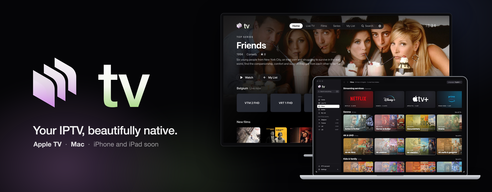
</p>

<p align="center">
  <a href="#apple-tv"></a>
  <a href="#mac"></a>
  
  
  
  <a href="LICENSE"></a>
</p>

<p align="center">
  <b>Live TV, films and series from your own IPTV provider, in an app that feels like it belongs on Apple TV and on the Mac.</b><br>
  One code base, one look. No account, channel list or content inside.
</p>

---

## Get the app

| Platform | How to get it |
|---|---|
| **Apple TV** | Through **TestFlight**: install the TestFlight app on the Apple TV, then redeem the invite you received. Or build it yourself (below). |
| **Mac** | Build it yourself (below), five minutes with Xcode. A signed download is not published yet. |
| **iPhone and iPad** | Planned. The shared code is ready for it. |

On first launch the app asks for your provider's server, username and password.

## Bring your own provider

Nexus TV works with any provider that uses the **Xtream Codes** API. The app ships empty: it checks the login with the
provider and keeps it in the Keychain of the device. Nothing is sent anywhere else. Several accounts can be kept and
switched in Settings.

<p align="center">
  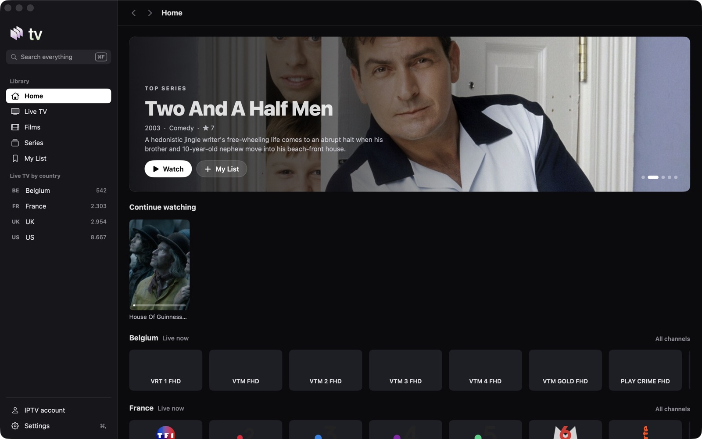
</p>

<table>
  <tr>
    <td width="50%">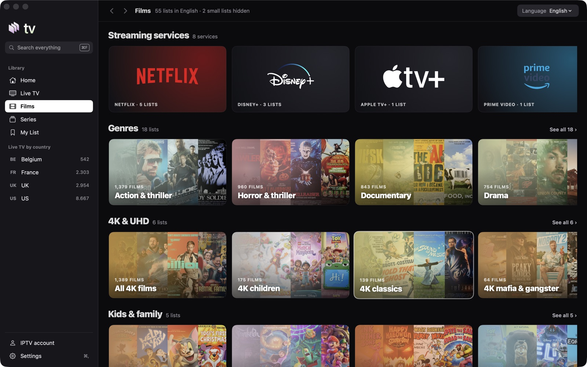<br><sub><b>Films and series as shelves</b>: streaming services, genres, 4K, kids, world cinema, collections. Small lists stay out of the way.</sub></td>
    <td width="50%">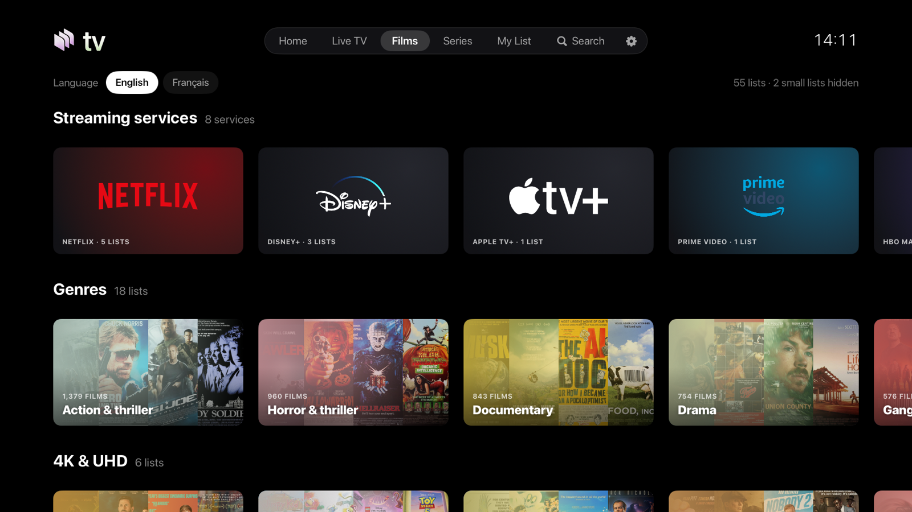<br><sub><b>The same shelves on Apple TV</b>, built for the Siri Remote.</sub></td>
  </tr>
  <tr>
    <td width="50%">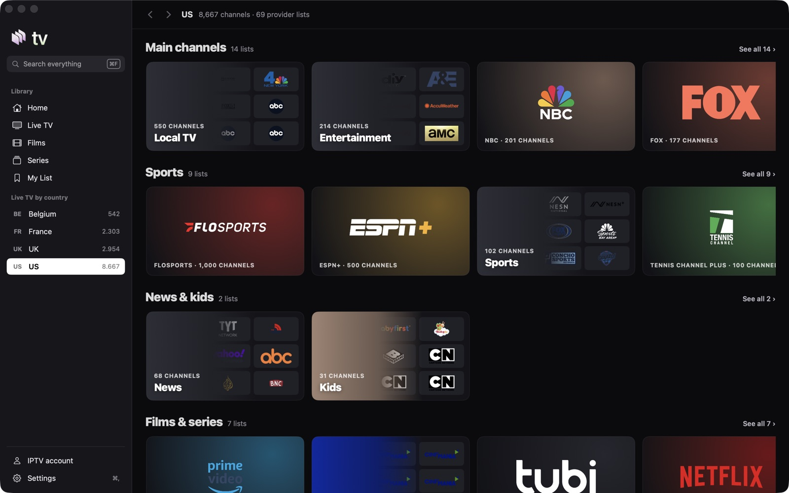<br><sub><b>Live TV</b>: a country, its lists as shelves, then the channels (with a preview in the Apple TV guide).</sub></td>
    <td width="50%">

**Highlights**
- Home with a rotating featured title, Continue watching, My List, live rows per country
- Channel guide by country and category, favourites first
- Next episode button and a 10 s countdown card, like a streaming service
- Audio and subtitle choice remembered per film and per series
- Online subtitles from your own OpenSubtitles account, matched to the exact file so they are in sync
- Auto reconnect when a stream drops

</td>
  </tr>
</table>

## A closer look

<table>
  <tr>
    <td width="50%">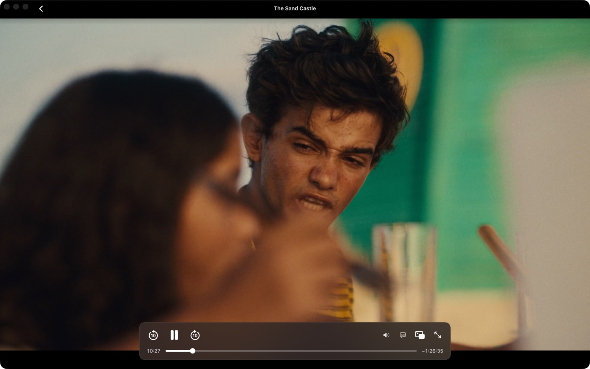<br><sub><b>Player</b>: floating controls that hide by themselves, 10 s jumps, audio, subtitles, picture in picture, full screen. On Apple TV, scrubbing a film shows the real frame at the marker.</sub></td>
    <td width="50%">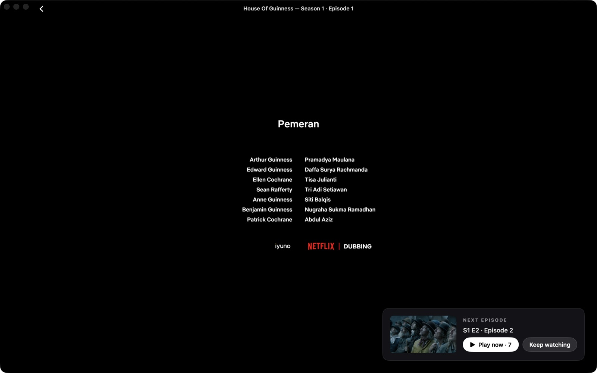<br><sub><b>Next episode</b>: a card with the episode's picture and a countdown appears over the credits; Play now or Keep watching.</sub></td>
  </tr>
  <tr>
    <td width="50%">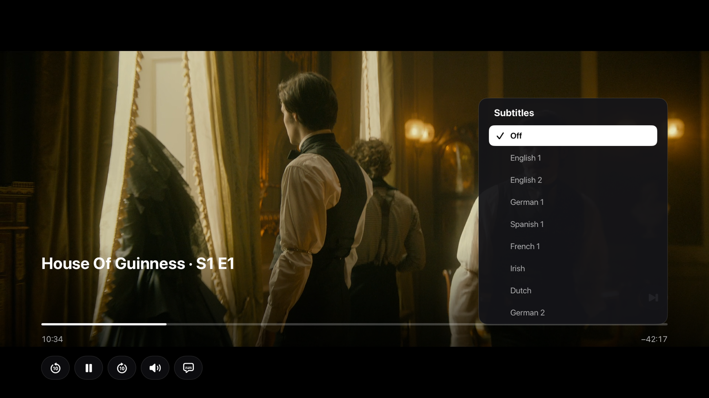<br><sub><b>Subtitles that stay in sync</b>: pick an online subtitle and the app lines it up by itself while you watch. It listens to the subtitle track inside the video, matches each spoken line to the downloaded one, and shifts the timing until they agree. A slow drift is followed; a file made for another cut is swapped for the next candidate.</sub></td>
    <td width="50%">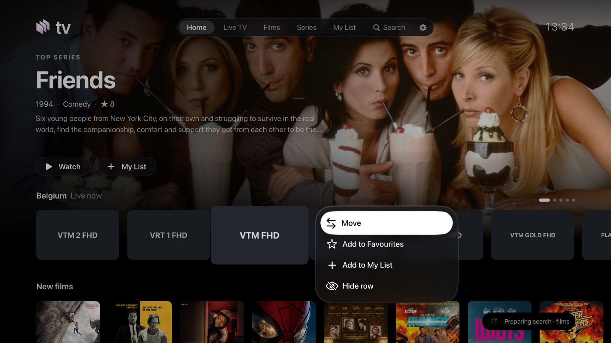<br><sub><b>Long press on Apple TV</b>: move a tile, favourite it, add it to My List, hide a row. Home becomes yours.</sub></td>
  </tr>
  <tr>
    <td width="50%">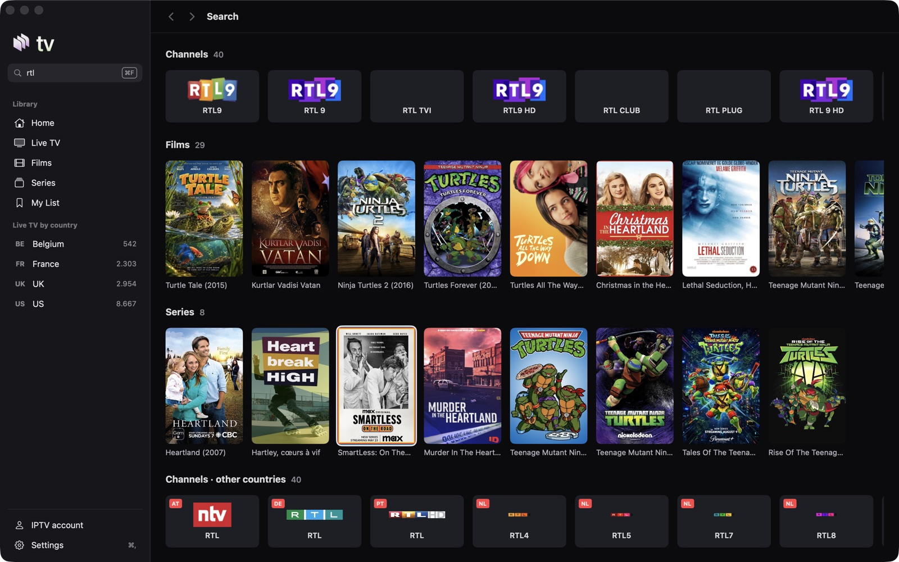<br><sub><b>Search everything</b>: channels, films and series together, your countries and languages first, the rest after.</sub></td>
    <td width="50%">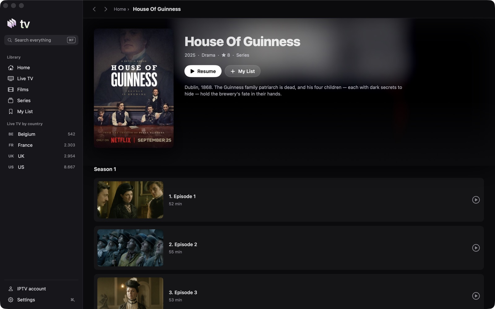<br><sub><b>Series page</b>: seasons, episodes with their picture and length, Resume where you stopped.</sub></td>
  </tr>
</table>

## Features

| | |
|---|---|
| 🏠 **Home** | Featured series on top, then rows: Continue watching, My List, a live row per country, New films, Top series, and any category you add. On Apple TV, long press a tile to favourite it, add it to My List, move it in its row, or hide the row. |
| 📺 **Live TV** | A country, then its lists as shelves with clean names (channels, films and series, sport, kids, documentary and music, streaming services, events last), then the channels (on Apple TV a guide with a preview). Favourite channels come first. Up and down change channel while watching. |
| 🎬 **Films and series** | Shelves per family with banner cards, a language filter, detail pages, seasons and episodes with their progress. Next episode plays by itself after a countdown. A **CC** badge marks titles known to have subtitles. |
| 🔎 **Search** | Everything at once: channels, films and series, in every language. On Apple TV, Apple's own search screen with dictation and typing from an iPhone. On the Mac, ⌘F. |
| ▶️ **Player** | VLCKit, live and on demand. Audio and subtitle tracks, scrubbing with the real frame on Apple TV, Next episode above the timeline. One stream at a time; it reconnects by itself after a network drop. On the Mac the player lives in the main window: picture in picture, full screen, Esc goes back. |
| 💬 **Online subtitles, in sync** | Optional, with your own OpenSubtitles account (**Settings › Subtitles**). The app first asks for subtitles made for your exact file (a fingerprint of the video), then the same frame rate and release. Then **live realignment**: while the film plays, the start of each line in the subtitle track inside the file is compared with the downloaded lines around it; the offset most lines agree on wins, within a minute of dialogue and with no press. A sliding window follows a slow drift, and after a minute without agreement the app switches to the next candidate. Earlier / Later still nudges by half a second, kept per file. It needs a subtitle track inside the video. On Apple TV and Mac the file must also be an MKV (MP4 files keep Earlier / Later only). |
| ⚙️ **Settings** | Menu tabs and Home rows (show, hide, reorder), countries, languages, **Lists** (any category of your account as a Home row), **Channels** (star any channel), **Accounts** (add, switch, remove), clear lists. |

After an account is added, the app downloads the full catalogue in the background to build its search index. A small
line shows the progress; Home and browsing never wait for it. The index refreshes once a day.

## Build and run

You need a Mac with **Xcode 16 or later** and [XcodeGen](https://github.com/yonaskolb/XcodeGen).

```bash
brew install xcodegen
git clone https://github.com/achammah/nexus-tv.git && cd nexus-tv
scripts/setup.sh          # signing team, VLCKit (large download, kept outside git), Xcode project
open NexusTV.xcodeproj
```

- **Signing**: `scripts/setup.sh` writes the git-ignored `Config/Signing.xcconfig` from the "Apple Development" identity in your keychain. Without one, copy `Config/Signing.example.xcconfig` to `Config/Signing.xcconfig` and set your team id, or pick the team in Xcode.

### Apple TV

Scheme **NexusTV**. Pick an Apple TV simulator or your Apple TV, then Run. From the command line:

```bash
xcodebuild -project NexusTV.xcodeproj -scheme NexusTV \
  -destination 'platform=tvOS Simulator,name=Apple TV 4K (3rd generation)' build
```

<details>
<summary><b>Install on your own Apple TV</b></summary>

1. Put the Apple TV and the Mac on the same network. On the Apple TV open **Settings › Remotes and Devices › Remote App and Devices** and leave that screen open.
2. On the Mac open **Xcode › Window › Devices and Simulators**. The Apple TV appears under *Discovered*: click **Pair** and type the code shown on the TV.
3. Choose the Apple TV as run destination and press **Run**.
4. With a free Apple ID the app runs for 7 days; with a paid developer account, a year. Rebuild to renew, or distribute it through TestFlight.

</details>

### Mac

Scheme **NexusTVMac**, destination *My Mac*, then Run. From the command line:

```bash
xcodebuild -project NexusTV.xcodeproj -scheme NexusTVMac -destination platform=macOS build
```

The app lands in Xcode's build products folder (`Nexus TV.app`); drag it to Applications. The Mac app uses a mouse and
keyboard: ⌘F search, ⌘[ and ⌘] back and forward, ⌘, Settings. In the player: space play or pause, ← → 10 s, ↑ ↓ change
channel, F full screen, Esc leaves full screen, then picture in picture, then the player.

<details>
<summary><b>Tests</b></summary>

- `NXTV_ACCOUNT_FILE=<file> scripts/uitest.sh`: Apple TV journeys driven with the Siri Remote (`XCUIRemote`) on the simulator whose id is in `build/sim-udid`. The file holds a real test login on 3 lines (server, username, password); keep it outside the repo. Logs are masked; captures go to `shots/remote/` (git-ignored).
- `scripts/mactest.sh`: the Mac journeys (they take the mouse and keyboard while they run).
- `scripts/perf.sh`, `scripts/perfkeys.sh`: speed runs with in-app metrics (`-NXMetrics YES`).
- `scripts/netcut.sh live|film`: plays through a local stand-in server and cuts it, to check the reconnect.
- More in [docs/TESTING.md](docs/TESTING.md).

</details>

## Project layout

One repository, one shared core, one folder per platform.

```
Shared/      Xtream client, catalogue, caches, stores, subtitles, VLCKit player controller
tvOS/        the Apple TV app: entry point, screens, assets
macOS/       the Mac app: window, sidebar, pages, player view, assets
iOS/         planned
Tests/       remote-driven journeys (tvOS), Mac journeys and unit tests
scripts/     setup, build and test helpers
project.yml  XcodeGen: targets NexusTV (tvOS) and NexusTVMac (macOS)
```

Git-ignored: `Vendor/` (VLCKit), `Config/Signing.xcconfig`, `build/`.

## Contributing

Issues and pull requests are welcome. Please never commit a provider address, a login or a catalogue file: the tests
read their login from a file outside the repo (`NXTV_ACCOUNT_FILE`).

## License

The code is under the [MIT license](LICENSE). VLCKit is downloaded at setup and is under the LGPL 2.1 (VideoLAN).
The Nexus name and logo are not covered by the MIT license.

> Nexus TV is a player only. It does not provide, host or link to any content. Use it only with a provider and streams
> you have the right to watch.
